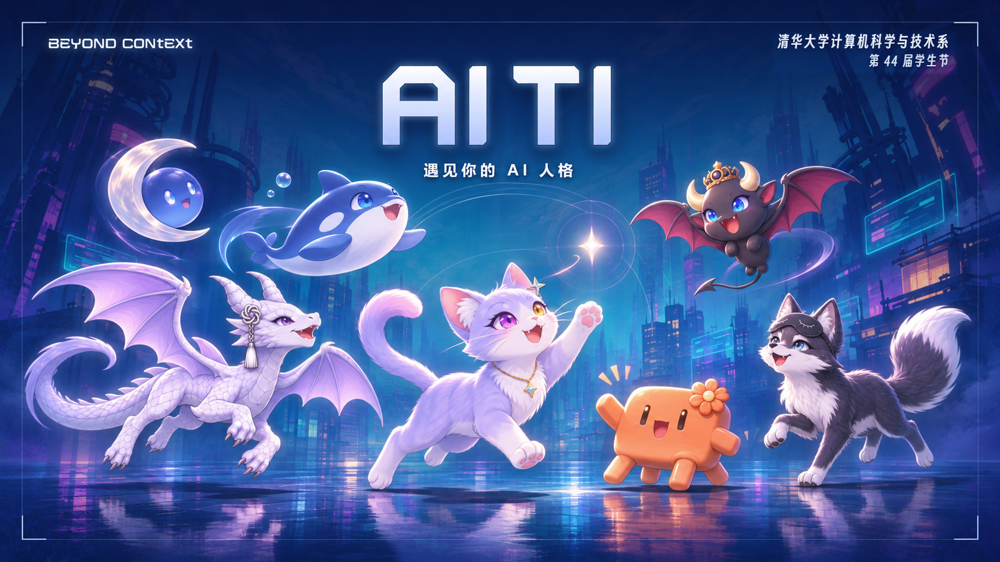

# AITI · Beyond Context

> 清华大学计算机科学与技术系第 44 届学生节 **Beyond Context** 路演互动项目。

**[在线体验 AITI](https://gmh06.github.io/AITI/)**

## 从答题到揭晓

在 10 道校园情境题中，选出最接近你平时做法的答案。AITI 根据**认知内核、思考倾向、对齐模式和交互姿态**四个维度计分，匹配 16 种人格之一。 [四维人格设定](docs/aiti_personality.md)

答完后，对应角色从圆形窥视孔中逐渐揭晓。你可以查看四维倾向和人格解读，也可以将结果保存为分享图。 [角色设计](docs/model_character.md) · [揭晓动画](docs/animation.md)

## 实现与部署

前端使用 React、TypeScript 和 Vite，发布在 GitHub Pages。答题、计分和分享图合成在浏览器中完成，累计参与次数由 Cloudflare Worker 和 D1 记录。 [系统设计](docs/system/design.md) · [计数服务](counter/README.md)

## 素材来源

- **活动视觉**　Beyond Context 官方字标和原始主视觉来自清华大学计算机科学与技术系第 44 届学生节。城市背景以活动主视觉为参考，使用 OpenAI 图像生成工具制作。 [字标与原始主视觉](asset/Festival/) · [背景制作记录](asset/design/backgrounds/v3/)
- **人形卡面**　GPT、DeepSeek、Claude、Gemini、Grok、GLM 和 Kimi 的人形设定参考 ZipZipPipe 的《AI娘化》。DeepSeek 鲸鱼娘的原角色由上善无形创作，蓝白女仆版由 ZipZipPipe 二次设计。豆包参考字节跳动豆包的品牌形象。AITI 卡面插画使用 AI 辅助制作。 [逐款来源、参考图核验范围与生成记录](docs/art/human.md#2-参考图与来源)
- **角色插画**　揭晓动画和结果页使用 AITI 制作的七款非人形插画，豆包沿用人形版。README 封面以七款非人形角色的四视图为参考，使用 AI 辅助绘制新动作。 [逐款设计来源](docs/art/nonhuman.md) · [四视图](asset/nonhuman/final/README.md) · [上线图像索引](asset/nonhuman/cards/source-map.json)
- **字体**　得意黑（Smiley Sans）、站酷庆科黄油体和 Audiowide 的字体文件及子集遵循各自的 SIL Open Font License 1.1。 [得意黑许可](web/assets/style/Smiley-Sans-OFL.txt) · [站酷庆科黄油体许可](asset/design/typography/fonts/zcoolqingkehuangyou/OFL.txt) · [Audiowide 许可](asset/design/typography/fonts/audiowide/OFL.txt)
- **品牌参考素材**　各 AI 产品的 App 图标、网页标志和吉祥物参考归相应权利人。部分参考文件的首发页面与再分发许可尚未核实。 [品牌参考目录](asset/icon/) · [素材索引](asset/README.md)

## 授权

**MIT License 仅适用于 AITI 贡献者有权授权的程序源代码**，包括网页程序、参与计数服务、测试、构建和制作脚本。题库、人格文案、插画、背景、卡面、活动字标、产品标志、字体及第三方参考图适用各自的权利与许可。 [MIT 许可证](LICENSE)

ZipZipPipe 的《AI娘化》合集要求署名和非商业使用。对继承 DeepSeek 鲸鱼娘设计的图像，应保留上善无形与 ZipZipPipe 的署名及来源，按 **CC BY-NC-SA 4.0** 使用，公开分享改编时标注修改并沿用同一许可。其他未列明开放许可的素材，复用前应向相应权利人确认许可。 [ZipZipPipe 作品说明](https://www.pixiv.net/artworks/148186519) · [上善无形原帖](https://www.bilibili.com/opus/1231977657712771073) · [CC BY-NC-SA 4.0](https://creativecommons.org/licenses/by-nc-sa/4.0/deed.zh-hans)

## 项目资料

- 网页题目、人格文案和计分规则见 [站点内容](web/src/content/)。设计和校对资料见 [题库](docs/tests_design.md) · [结果页文案](docs/result_page.md) · [测试与验收](docs/system/verification.md)。
- 纪念卡成品、分层源文件和制作记录见 [素材目录](asset/README.md)。早期策划和试稿见 [整理前的仓库版本](https://github.com/gmh06/AITI/tree/a6692286c70f86d2cd26437ba15f5adb882fc83a)。

## 项目贡献者

- [gmh06](https://github.com/gmh06)
- [Zaogezi](https://github.com/Zaogezi)
